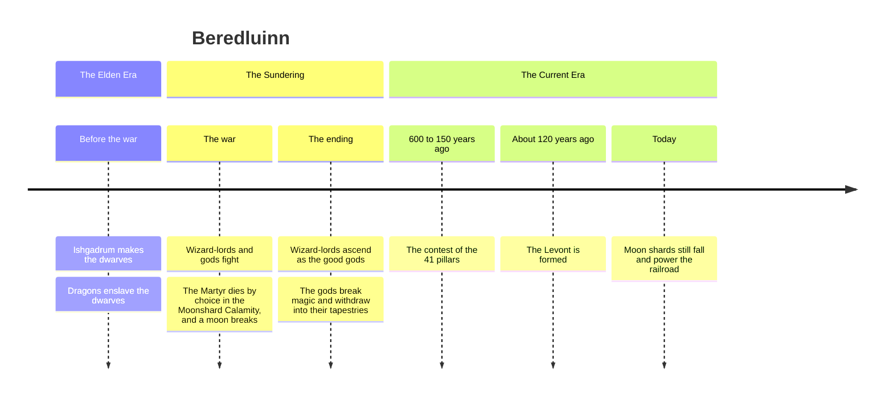

# Timeline

Two eras so far: [[The Elden Era]] and [[The Current Era]]. [[The Sundering]] is the war that ended the first and began the second.

**Dates decided 22 October 2026** (10.1, 2.1), counted in years before the present. What year 1 is, and what the calendar calls it, is still open (14.19, [[Calendar Setup]]). The layers follow [[Fantasy Forge Lessons]]: what everyone knows, what some know, what is mostly forgotten.

| Years ago | Event | History layer |
| --- | --- | --- |
| Thousands | [[The Elden Era]]: no gods, only wizard-lords, who make the races ([[Ishgadrum]] makes the [[Dwarves]]). The [[Dragons]] rule and enslave the dwarves. The Eldfolk, the first humans, build the city under the plains ([[Great Houses of the Levont#Waves of settlement (decided 2 Nov)]]) | Mostly forgotten |
| About 600 | [[The Sundering]], the Moonshard Calamity and [[The Apotheosis]]. The dwarves are freed as the dragons fall. Knights of a human border kingdom follow [[The Sunturner]] into the war and found the [[Order of the Rising Sun]] | Some know. Very old elves remember |
| About 550 to 450 | The Comers, ancestors of four of the five old countries, come through the March gate and by sea, fleeing lands the Sundering ruined (2 Nov) | Everyone knows a version |
| About 300 | The War of the Toll Chains: House Strommund chains the rivers, House Gundberg burns Kaufwerth ([[Great Houses of the Levont]], 2 Nov) | Some know |
| 600 to 150 | The old countries rise. The [[Aelnor]] kingdom falls. [[The Contest of the 41 Pillars]] | Some know |
| About 120 | [[The Founding of the Levont]], under pressure from the horde | Grandparents' stories |
| 120 to 80 | A strong regency centralises; its bailiffs and laws are still in use | Everyone knows |
| About 50 | The first [[The Railroad\|railroad]] line | Living memory |
| About 30 | An Engelbrekt-style rising, crushed or co-opted, with a local hero | Living memory |
| Now | The horde's khan has just died (decided 25 Oct, [[Lorweir]]). Why now is otherwise still open | Current news |

The middle three rows come from the five-step shape in [[Kalmar Union Lessons]].

The table below lists the same events with their notes. Exact years for the 600-to-150 window are still open.

| Event | Era | Notes |
| --- | --- | --- |
| [[Ishgadrum]] makes the [[Dwarves]] | [[The Elden Era]] | Before the war. Some gods predate it |
| Dwarves enslaved by [[Dragons]] | [[The Elden Era]] | Length unknown (11.2) |
| [[The Sundering]] (the war) | End of [[The Elden Era]] | About 600 years ago. Lords and gods fight. Elves fight beside the good gods |
| [[The Moon's Shattering\|The Moonshard Calamity]] | During the Sundering | The Martyr chooses to die. Her essence shatters to create the tapestries, and a moon breaks into a debris belt |
| [[The Apotheosis]] | End of the Sundering | Many war lords become the good gods |
| Magic broken, gods withdraw | End of the Sundering | See [[Magic]], [[The Tapestries]] |
| [[The Contest of the 41 Pillars]] | [[The Current Era]] | "After the sundering", before the founding (decided 22 Oct: 600 to 150 years ago) |
| [[The Founding of the Levont]] | [[The Current Era]] | About 120 years ago (decided 22 Oct) |
| [[Moon Shards]] keep falling | Today | Fuel for magic and [[The Railroad]] |

## The Ascension War (open, 26 Oct)
You called the war in which the wizards became gods **the ascension war**, and said it is the war the Levont was created by. That clashes with the dates above, so it's saved to sit down with at home.
- The vault places [[The Apotheosis]] at the end of [[The Sundering]], about 600 years ago, and the founding about 120 years ago.
- **Option 1: the Ascension War *is* the Sundering**, about 600 years ago. The wizards rise, the dwarf empire breaks, and the Levont is founded much later on its ruins. This matches what the vault already says.
- **Option 2: they are separate wars.** The Sundering comes first, and an Ascension War about 120 years ago creates the Levont. Then the channels, the Apotheosis and the gods' withdrawal all need new dates.

What hangs on it:
- [[The Channels]], built during the ascension war.
- **The elves' maker.** Elves live about 400 years and are reborn ([[Death and the Afterlife#Elves are reborn (decided 26 Oct)]]), and a god made them. If that god ascended in the war, were there elves before it? The vault has elven cities in the Elden Era.
- **The dwarves' freedom** from the [[Dragons]], dated to the end of the Sundering.

## Open questions
From [[Open Questions]]. Numbers match the source doc.
- ~~**2.1** How long ago did the Levont come together?~~ (Answered 22 Oct: about 120 years.)
- ~~**10.1** What order, and how many centuries ago?~~ (Answered 22 Oct: see the table above.)
- **11.2** Dwarf timeline: created, enslaved, freed (about 600 years ago, as the dragons fell), joined. Who freed them?
- When exactly did the Aelnor kingdom fall, and the 41 pillars contest happen, within the 600-to-150 window?
- ~~How long do elves live (10.4)?~~ (Answered 26 Oct: about 400 years, then they are reborn. No elf alive saw the Sundering, but strong souls may remember it from a past life. See [[Death and the Afterlife#Elves are reborn (decided 26 Oct)]].)
- **12.1** (Answered) The whole war and how it ended.
- Did the Apotheosis come just before or just after the Sundering?
